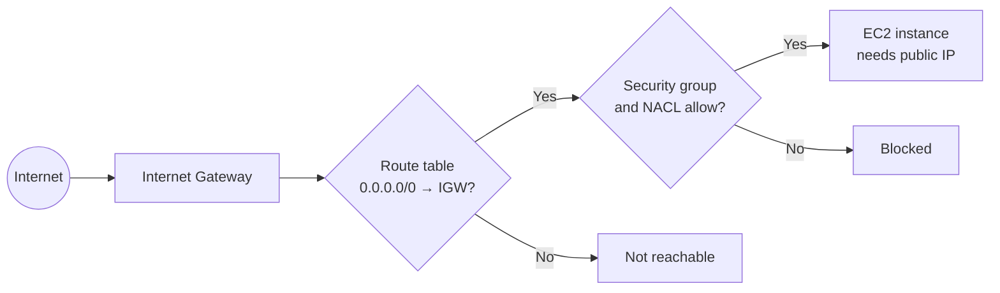

# CIDR, Subnetting, Supernetting and AWS Subnets: A Study Guide

Think of an IP address range as a large office building. You can **divide** the building into smaller departments (subnetting), or **combine** several small neighboring offices into one larger administrative unit (supernetting). Both operations use the **CIDR prefix** (such as `/24`, `/25`, or `/23`) to say how many addresses belong to a network.

## Table of Contents

**Part 1: Foundations**
1. [IP addresses and bits](#1-ip-addresses-and-bits)
2. [The CIDR prefix](#2-the-cidr-prefix)
3. [Ranges that don't line up with the dots](#3-ranges-that-dont-line-up-with-the-dots)

**Part 2: Subnetting (splitting)**

4. [What is subnetting?](#4-what-is-subnetting)
5. [Splitting a /24 into two /25 networks](#5-splitting-a-24-into-two-25-networks)
6. [Why does increasing the prefix split a network?](#6-why-does-increasing-the-prefix-split-a-network)
7. [Splitting into four /26 subnets and the block-size rule](#7-splitting-into-four-26-subnets-and-the-block-size-rule)
8. [Why companies use subnetting](#8-why-companies-use-subnetting)
9. [Worked example: /20 subnets inside 172.31.0.0/16](#9-worked-example-20-subnets-inside-172310016)

**Part 3: Supernetting (combining)**

10. [What is supernetting?](#10-what-is-supernetting)
11. [Combining two /24 networks into a /23](#11-combining-two-24-networks-into-a-23)
12. [Route summarization](#12-route-summarization)
13. [The alignment condition](#13-the-alignment-condition)
14. [Subnetting vs supernetting](#14-subnetting-vs-supernetting)

**Part 4: Extra networking concepts**

15. [Private ranges, special prefixes, and longest prefix match](#15-private-ranges-special-prefixes-and-longest-prefix-match)

**Part 5: CIDR in AWS**

16. [CIDR rules in an AWS VPC](#16-cidr-rules-in-an-aws-vpc)
17. [`MapPublicIpOnLaunch` explained](#17-mappubliciponlaunch-explained)

**Part 6: Review and practice**

18. [Cheat sheet](#18-cheat-sheet)
19. [Practice MCQs](#19-practice-mcqs)
20. [Answer key](#20-answer-key)

---

# Part 1: Foundations

## 1. IP addresses and bits

An IPv4 address has **32 bits**, split into four groups of 8 bits called **octets**:

```
192      .  168      .  1        .  10
11000000 .  10101000 .  00000001 .  00001010
8 bits      8 bits      8 bits      8 bits   = 32 bits
```

Each octet is a number from **0 to 255** (256 possible values).

A CIDR range describes a **whole group** of addresses at once, for example `192.168.1.0/24`:

- The part before the slash (`192.168.1.0`) is the **starting address**.
- The number after the slash (`/24`) says **how many bits are fixed** (the network part).

**A bigger number after the slash means a smaller group.**

---

## 2. The CIDR prefix

For `192.168.1.0/24`:

- **24 bits** identify the network portion.
- The remaining **32 − 24 = 8 bits** identify addresses within that network.

The number of addresses is:

```
Total addresses = 2^(32 - prefix)
```

For `/24`:

```
2^(32 - 24) = 2^8 = 256
```

So `192.168.1.0/24` contains **256 total addresses**, from `192.168.1.0` to `192.168.1.255`.

Think of a street address: the street name stays the same for everyone on the block (network part), and the house number changes (host part).

### Network and broadcast addresses

In a typical IPv4 subnet, two addresses are reserved:

- The **first** address is the **network address** (the name of the group).
- The **last** address is the **broadcast address** (used to talk to everyone).

So usable hosts are normally `2^(32 - prefix) - 2`. A `/24` gives **254 usable addresses**.

### Prefix reference table

| CIDR | Network bits | Host bits | Subnet mask | Total addresses | Usable hosts (typical) |
|------|:-----------:|:---------:|-------------|----------------:|-----------------------:|
| /8   | 8  | 24 | 255.0.0.0       | 16,777,216 | 16,777,214 |
| /16  | 16 | 16 | 255.255.0.0     | 65,536 | 65,534 |
| /20  | 20 | 12 | 255.255.240.0   | 4,096 | 4,094 |
| /22  | 22 | 10 | 255.255.252.0   | 1,024 | 1,022 |
| /23  | 23 | 9  | 255.255.254.0   | 512 | 510 |
| /24  | 24 | 8  | 255.255.255.0   | 256 | 254 |
| /25  | 25 | 7  | 255.255.255.128 | 128 | 126 |
| /26  | 26 | 6  | 255.255.255.192 | 64 | 62 |
| /27  | 27 | 5  | 255.255.255.224 | 32 | 30 |
| /28  | 28 | 4  | 255.255.255.240 | 16 | 14 |
| /29  | 29 | 3  | 255.255.255.248 | 8 | 6 |
| /30  | 30 | 2  | 255.255.255.252 | 4 | 2 |
| /32  | 32 | 0  | 255.255.255.255 | 1 | single host |

---

## 3. Ranges that don't line up with the dots

Most real-life cases aren't `/8`, `/16`, or `/24`. Take **`192.168.1.64/26`**.

### Step 1: Count the free bits

```
32 - 26 = 6 free bits  →  2^6 = 64 addresses per block
```

### Step 2: Understand why the last octet splits into blocks of 64

The first three octets use 24 bits. A `/26` uses **2 more bits** from the last octet, so:

- **2 bits are fixed** (network)
- **6 bits are free** (host)

Two fixed bits make 4 combinations (`00`, `01`, `10`, `11`). Each combination is its own block, so the 256 values of the last octet are cut into **4 equal blocks**:

| Fixed 2 bits | Free 6 bits | Decimal range |
|:------------:|-------------|---------------|
| `00` | `000000` to `111111` | **0 to 63** |
| `01` | `000000` to `111111` | **64 to 127** |
| `10` | `000000` to `111111` | **128 to 191** |
| `11` | `000000` to `111111` | **192 to 255** |

In binary, the start and end of the second block look like this:

```
64  = 01 000000
127 = 01 111111
```

The first two bits (`01`) stay fixed. Only the last six bits change.

### Step 3: Find which block your address falls in

The last octet of `192.168.1.64` is **64**, which is exactly the start of the second block.

**Range: `192.168.1.64` to `192.168.1.127`**

### The shortcut

1. Block size = `2^(free bits)` = 64
2. Count from 0 in steps of the block size: 0, 64, 128, 192
3. Each block runs from its start up to just before the next start

### Another example: `192.168.1.200/26`

200 falls in the 192 to 255 block, so the range is **`192.168.1.192` to `192.168.1.255`**.

### Same idea, other sizes

| CIDR | Free bits | Block size | Blocks start at |
|------|:---------:|:----------:|-----------------|
| /25 | 7 | 128 | 0, 128 |
| /26 | 6 | 64  | 0, 64, 128, 192 |
| /27 | 5 | 32  | 0, 32, 64, 96, 128, 160, 192, 224 |
| /28 | 4 | 16  | 0, 16, 32, 48, ... |

---

# Part 2: Subnetting (splitting)

## 4. What is subnetting?

**Subnetting** means dividing a larger network into smaller networks. You do it by **increasing** the prefix number. Each +1 splits a block in half.

Example scenario: a company has `192.168.1.0/24` and wants two departments:

- Department A: 100 employees
- Department B: 100 employees

Instead of one flat network, it can be divided into two `/25` networks.

---

## 5. Splitting a /24 into two /25 networks

**Starting network:** `192.168.1.0/24` (256 addresses, 24 network bits, 8 host bits)

Increase the prefix from `/24` to `/25`:

| Subnet | Network | Total addresses | Usable (typical) | Last-octet range |
|--------|---------|----------------:|-----------------:|------------------|
| A | `192.168.1.0/25`   | 128 | 126 | .0 to .127 |
| B | `192.168.1.128/25` | 128 | 126 | .128 to .255 |

Each department's 100 employees fit comfortably in 126 usable addresses.

---

## 6. Why does increasing the prefix split a network?

The original `/24` has 24 network bits and 8 host bits. Changing `/24` to `/25` **moves one bit from the host portion to the network portion**.

| Prefix | Network bits | Host bits | Total addresses | Usable hosts |
|--------|:-----------:|:---------:|----------------:|-------------:|
| /24 | 24 | 8 | 256 | 254 |
| /25 | 25 | 7 | 128 | 126 |
| /26 | 26 | 6 | 64  | 62 |
| /27 | 27 | 5 | 32  | 30 |
| /28 | 28 | 4 | 16  | 14 |
| /29 | 29 | 3 | 8   | 6 |
| /30 | 30 | 2 | 4   | 2 |

Every +1 on the prefix removes one host bit. Since address counts are powers of two, the count is **halved**:

```
2^8 = 256,   2^7 = 128,   2^6 = 64
```

That is why every +1 splits a block into **two equal blocks**.

---

## 7. Splitting into four /26 subnets and the block-size rule

Suppose the company wants separate networks for four teams. Start with `192.168.1.0/24` and increase the prefix to `/26` (6 host bits, so 64 addresses each).

| Subnet | Network | Usable hosts | Last-octet range |
|:------:|---------|-------------:|------------------|
| 1 | `192.168.1.0/26`   | 62 | .0 to .63 |
| 2 | `192.168.1.64/26`  | 62 | .64 to .127 |
| 3 | `192.168.1.128/26` | 62 | .128 to .191 |
| 4 | `192.168.1.192/26` | 62 | .192 to .255 |

The starting addresses are `.0`, `.64`, `.128`, `.192`, an **increment of 64**, because each subnet has 64 total addresses.

### Block-size rule

```
Block size = 256 - (subnet mask octet)
```

For `/26`, the mask is `255.255.255.192`, so the block size is `256 - 192 = 64`.

### Number of subnets from added bits

If you add **n** bits to the prefix, you get **2^n** subnets.

| Original | New prefix | Bits added | Subnets created |
|----------|-----------|:----------:|:---------------:|
| /24 | /25 | 1 | 2 |
| /24 | /26 | 2 | 4 |
| /24 | /27 | 3 | 8 |
| /24 | /28 | 4 | 16 |
| /16 | /20 | 4 | 16 |

---

## 8. Why companies use subnetting

| Department | Example subnet | Purpose |
|------------|----------------|---------|
| Development | `192.168.1.0/26`   | Developer computers |
| Testing     | `192.168.1.64/26`  | Testing machines |
| Servers     | `192.168.1.128/26` | Application and database servers |
| Guest Wi-Fi | `192.168.1.192/26` | Visitors' devices |

Subnetting helps organizations:

- **Separate traffic:** devices in different subnets typically communicate through a router or Layer 3 switch.
- **Improve security:** firewall rules can restrict guest devices from reaching internal servers.
- **Use addresses efficiently:** small teams get smaller address ranges.
- **Simplify management:** each department or environment gets its own network configuration.

> **Important:** creating subnets alone does not automatically secure them. Security also depends on routing, firewall rules, access controls, and other network configuration.

---

## 9. Worked example: /20 subnets inside 172.31.0.0/16

`172.31.0.0/16` is the range AWS uses for its **default VPC**. What does a `/20` subnet mean inside it?

- First **20 bits** are fixed, remaining **12 bits** are free.
- Addresses per subnet: `2^12 = 4,096`
- In AWS, 5 are reserved, so **4,091 are usable**.
- A `/20` adds **4 bits** to the `/16`, so you get `2^4 =` **16 possible subnets**.

Those 4 extra bits live in the **third octet**, so it changes in steps of **16** (block size `2^4 = 16`).

| # | Subnet | Address range |
|:-:|--------|---------------|
| 1  | `172.31.0.0/20`   | 172.31.0.0 to 172.31.15.255 |
| 2  | `172.31.16.0/20`  | 172.31.16.0 to 172.31.31.255 |
| 3  | `172.31.32.0/20`  | 172.31.32.0 to 172.31.47.255 |
| 4  | `172.31.48.0/20`  | 172.31.48.0 to 172.31.63.255 |
| 5  | `172.31.64.0/20`  | 172.31.64.0 to 172.31.79.255 |
| 6  | `172.31.80.0/20`  | 172.31.80.0 to 172.31.95.255 |
| 7  | `172.31.96.0/20`  | 172.31.96.0 to 172.31.111.255 |
| 8  | `172.31.112.0/20` | 172.31.112.0 to 172.31.127.255 |
| 9  | `172.31.128.0/20` | 172.31.128.0 to 172.31.143.255 |
| 10 | `172.31.144.0/20` | 172.31.144.0 to 172.31.159.255 |
| 11 | `172.31.160.0/20` | 172.31.160.0 to 172.31.175.255 |
| 12 | `172.31.176.0/20` | 172.31.176.0 to 172.31.191.255 |
| 13 | `172.31.192.0/20` | 172.31.192.0 to 172.31.207.255 |
| 14 | `172.31.208.0/20` | 172.31.208.0 to 172.31.223.255 |
| 15 | `172.31.224.0/20` | 172.31.224.0 to 172.31.239.255 |
| 16 | `172.31.240.0/20` | 172.31.240.0 to 172.31.255.255 |

### Reading one example in binary

`172.31.16.0/20`, third octet = `0001 0000`:

- First 4 bits (`0001`) are fixed (network).
- Last 4 bits (`0000` to `1111`) plus the whole fourth octet are free.
- Third octet runs from `0001 0000` (16) to `0001 1111` (31); fourth octet runs 0 to 255.

Result: **172.31.16.0 to 172.31.31.255**.

### Practical notes

- Subnets in one VPC **must not overlap**.
- Each `/20` must start on a multiple of 16 in the third octet.
- A `/20` is large. If you only need a few hundred IPs per subnet, a `/24` (256 addresses) or `/23` wastes less of your `/16`.
- You can mix sizes (for example a `/20` for app servers and a few `/24`s for small tiers), as long as nothing overlaps.

---

# Part 3: Supernetting (combining)

## 10. What is supernetting?

**Supernetting** means combining multiple smaller, **contiguous** networks into one larger network. You do it by **decreasing** the prefix number.

It is the reverse of subnetting: instead of cutting a block in half, you merge neighboring blocks.

---

## 11. Combining two /24 networks into a /23

An organization has two networks:

| Network | Range | Addresses |
|---------|-------|----------:|
| A: `10.0.0.0/24` | 10.0.0.0 to 10.0.0.255 | 256 |
| B: `10.0.1.0/24` | 10.0.1.0 to 10.0.1.255 | 256 |

Together they hold 512 addresses and can be represented as one network:

**`10.0.0.0/23`**: range 10.0.0.0 to 10.0.1.255, 512 total addresses.

### Why does decreasing the prefix combine networks?

| Network | Network bits | Host bits | Total addresses |
|---------|:-----------:|:---------:|----------------:|
| `10.0.0.0/24` | 24 | 8 | 2^8 = 256 |
| `10.0.0.0/23` | 23 | 9 | 2^9 = 512 |

Decreasing the prefix gives **one more bit to the host portion**, which doubles the capacity. The resulting `/23` contains both original `/24` ranges.

### Subnet mask changes

| Prefix | Subnet mask | Total addresses |
|--------|-------------|----------------:|
| /24 | 255.255.255.0   | 256 |
| /23 | 255.255.254.0   | 512 |
| /22 | 255.255.252.0   | 1,024 |

For a `/23`, the third octet has a block size of `256 - 254 = 2`. Valid network boundaries in that octet are 0, 2, 4, 6, and so on. That is why `10.0.0.0/23` covers third-octet values **0 and 1**.

---

## 12. Route summarization

Supernetting is often used for **route summarization** (also called **route aggregation**).

A router manages four networks:

- `10.0.0.0/24`
- `10.0.1.0/24`
- `10.0.2.0/24`
- `10.0.3.0/24`

Instead of advertising four routes, it can advertise one summary route: **`10.0.0.0/22`**.

Why `/22`? Four `/24` networks contain:

```
4 x 256 = 1,024 = 2^10
```

A `/22` has `32 - 22 = 10` host bits, giving 1,024 addresses. The summary covers `10.0.0.0` through `10.0.3.255`.

| Before summarization | After summarization |
|----------------------|---------------------|
| 10.0.0.0/24 | |
| 10.0.1.0/24 | **10.0.0.0/22** |
| 10.0.2.0/24 | (one route instead of four) |
| 10.0.3.0/24 | |

**Benefits:**

- Smaller routing tables
- Fewer routes to distribute between routers
- More efficient routing updates
- Easier management of large networks

> A summary route does **not** mean the four networks have physically become one LAN. It means a router can represent their address ranges with a single routing entry, provided the network design and routing configuration support it.

---

## 13. The alignment condition

You cannot combine any two networks just because their ranges look close together. To merge two `/24` networks into a `/23`, they must be **adjacent** and start on a **valid `/23` boundary**.

| Pair | Can merge exactly into a /23? | Why |
|------|:-----------------------------:|-----|
| `10.0.0.0/24` + `10.0.1.0/24` | Yes | Starts at an even third-octet value (0) |
| `10.0.2.0/24` + `10.0.3.0/24` | Yes | Starts at an even value (2) |
| `10.0.1.0/24` + `10.0.2.0/24` | **No** | Starts at an odd value (1); they sit in two different `/23` blocks |

A `/23` must begin at an **even** third-octet value. The `/23` at `10.0.0.0` covers values 0 and 1; the one at `10.0.2.0` covers 2 and 3.

Covering `10.0.1.0/24` and `10.0.2.0/24` with a single prefix would require `10.0.0.0/22`, which also includes `10.0.0.0/24` and `10.0.3.0/24`. That can work as a broader summary in some routing designs, but it is not an exact combination of just those two ranges.

**General rule:** a block of size `N` must start at a multiple of `N`.

---

## 14. Subnetting vs supernetting

| Feature | Subnetting | Supernetting |
|---------|------------|--------------|
| Meaning | Split a network | Combine network ranges |
| Prefix change | **Increase** (`/24` to `/25`) | **Decrease** (`/24` to `/23`) |
| Address capacity per block | Decreases | Increases |
| Example | `/24` to two `/25` blocks | Two `/24` blocks to one `/23` |
| Main purpose | Segmentation and address allocation | Route summarization and simpler routing |

**Easy way to remember**

- **Subnetting:** `/24` to `/25` to `/26`: more networks, smaller blocks.
- **Supernetting:** `/24 + /24` to `/23`: fewer summarized routes, larger blocks.

The key principle: the CIDR prefix tells you how many bits identify the network. **More network bits mean smaller address blocks; fewer network bits mean larger address blocks.**

---

# Part 4: Extra networking concepts

## 15. Private ranges, special prefixes, and longest prefix match

### Private IPv4 ranges (not routable on the public internet)

| Range | Size | Common use |
|-------|------|------------|
| `10.0.0.0/8`     | 16,777,216 addresses | Large organizations, cloud VPCs |
| `172.16.0.0/12`  | 1,048,576 addresses | Mid-size networks (includes AWS default VPC `172.31.0.0/16`) |
| `192.168.0.0/16` | 65,536 addresses | Home and small office |

### Special prefixes

| Prefix | Meaning |
|--------|---------|
| `/32` | A single host (common in firewall rules) |
| `/31` | Point-to-point link (no broadcast needed) |
| `0.0.0.0/0` | "Any address" (default routes, "allow all" rules) |

### Longest prefix match

When a router has overlapping routes, it picks the **most specific** one (the largest prefix number).

For a packet going to `10.1.1.50`, with these routes:

```
10.0.0.0/8
10.1.0.0/16
10.1.1.0/24   ← wins (most specific)
```

### IPv6

Works the same way but with **128 bits**. A `/64` is the standard size for a single network, giving 2^64 addresses.

---

# Part 5: CIDR in AWS

## 16. CIDR rules in an AWS VPC

| Topic | Rule |
|-------|------|
| VPC CIDR size | Between `/16` (largest) and `/28` (smallest) |
| Subnet CIDR size | Between `/16` and `/28`, and must sit **inside** the VPC CIDR |
| Overlap | Subnets in the same VPC **cannot overlap** |
| Reserved addresses | **5 per subnet** (see below) |
| Availability Zone | Each subnet lives in **one** AZ |
| Default VPC | `172.31.0.0/16`, one default `/20` subnet per AZ |
| VPC peering | Peered VPCs must **not** have overlapping CIDRs |

### The 5 reserved addresses (example: `10.0.0.0/24`)

| Address | Purpose |
|---------|---------|
| `10.0.0.0`   | Network address |
| `10.0.0.1`   | VPC router |
| `10.0.0.2`   | Amazon-provided DNS |
| `10.0.0.3`   | Reserved for future use |
| `10.0.0.255` | Broadcast address (not supported, but reserved) |

So usable addresses in AWS are `2^(32 - prefix) - 5`:

| Subnet size | Total | Usable in AWS |
|-------------|------:|--------------:|
| /28 | 16 | 11 |
| /24 | 256 | 251 |
| /20 | 4,096 | 4,091 |

---

## 17. `MapPublicIpOnLaunch` explained

### What it is

`MapPublicIpOnLaunch` is a **subnet-level setting**, not a VPC-level setting. In the AWS Console it appears as **"Auto-assign public IPv4 address."**

| Value | Behavior |
|-------|----------|
| `true`  | Instances launched in this subnet automatically receive a public IPv4 address |
| `false` | Instances receive only a private IP (from the subnet's CIDR range) unless a public IP is requested at launch |

Naming across tools:

| Tool | Name |
|------|------|
| CloudFormation | `MapPublicIpOnLaunch` |
| Terraform | `map_public_ip_on_launch` |
| AWS CLI | `--map-public-ip-on-launch` / `--no-map-public-ip-on-launch` |

### Defaults

| Subnet type | Default |
|-------------|---------|
| Default VPC subnets | `true` |
| Subnets you create yourself | `false` |

### How it affects your VPC

It does **not** change the VPC as a whole. It only influences **new instances launched in that specific subnet**.

1. **Existing instances are not affected.** Changing the setting applies only to instances launched afterward.
2. **It can be overridden per instance.** The launch-time "Auto-assign Public IP" option on the network interface takes priority over the subnet default.
3. **The public IP is temporary.** It is *not* an Elastic IP. It is released when the instance stops or terminates, so it changes after a stop/start cycle.
4. **It applies to the primary network interface only** (the one created at launch).

### Common misunderstanding: it does not make a subnet public

A **public subnet** is defined by its **route table**, which must contain a route to an Internet Gateway:

```
Destination     Target
0.0.0.0/0   →   igw-xxxxxxxx
```

For an instance to be reachable from the internet, **all** of the following are needed:

| Requirement | Purpose |
|-------------|---------|
| Public IPv4 address | Gives the instance an internet-routable address |
| Internet Gateway attached to the VPC | The door to the internet |
| Route to the IGW in the subnet's route table | Sends traffic through that door |
| Security group and NACL rules allowing traffic | Permission to pass |

Failure scenarios:

- `MapPublicIpOnLaunch = true` but **no IGW route**: the instance has a public IP that does not work.
- IGW route present but **no public IP**: the instance is not reachable from the internet.



### Public DNS names

For an instance to also receive a public DNS hostname (for example `ec2-3-x-x-x.compute-1.amazonaws.com`), the VPC must have **DNS hostnames** enabled (`enableDnsHostnames = true`). DNS resolution (`enableDnsSupport`) must also be on, which it is by default.

### How to set it

**AWS Console**

1. Open **VPC** → **Subnets**.
2. Select the subnet.
3. Choose **Actions** → **Edit subnet settings**.
4. Tick or untick **Enable auto-assign public IPv4 address**.
5. Choose **Save**.

**AWS CLI**

```bash
# Enable
aws ec2 modify-subnet-attribute \
  --subnet-id subnet-0123456789abcdef0 \
  --map-public-ip-on-launch

# Disable
aws ec2 modify-subnet-attribute \
  --subnet-id subnet-0123456789abcdef0 \
  --no-map-public-ip-on-launch

# Check the current value
aws ec2 describe-subnets \
  --subnet-ids subnet-0123456789abcdef0 \
  --query "Subnets[0].MapPublicIpOnLaunch"
```

**Terraform**

```hcl
resource "aws_subnet" "public" {
  vpc_id                  = aws_vpc.main.id
  cidr_block              = "10.0.1.0/24"
  availability_zone       = "us-east-1a"
  map_public_ip_on_launch = true

  tags = {
    Name = "public-subnet-a"
  }
}
```

**CloudFormation**

```yaml
PublicSubnet:
  Type: AWS::EC2::Subnet
  Properties:
    VpcId: !Ref MyVPC
    CidrBlock: 10.0.1.0/24
    AvailabilityZone: us-east-1a
    MapPublicIpOnLaunch: true
```

### Overriding it per instance

The subnet setting is only a default. You can override it at launch.

```bash
# Force a public IP, even if the subnet default is false
aws ec2 run-instances \
  --image-id ami-0123456789abcdef0 \
  --instance-type t3.micro \
  --subnet-id subnet-0123456789abcdef0 \
  --associate-public-ip-address

# Force no public IP, even if the subnet default is true
aws ec2 run-instances \
  --image-id ami-0123456789abcdef0 \
  --instance-type t3.micro \
  --subnet-id subnet-0123456789abcdef0 \
  --no-associate-public-ip-address
```

```hcl
resource "aws_instance" "web" {
  ami                         = "ami-0123456789abcdef0"
  instance_type               = "t3.micro"
  subnet_id                   = aws_subnet.public.id
  associate_public_ip_address = true # overrides the subnet default
}
```

Launch templates and Auto Scaling groups have their own network interface setting for "Auto-assign public IP". If it is set explicitly, it overrides the subnet default. If left unset, the subnet setting applies.

### Troubleshooting

| Symptom | Likely cause | Fix |
|---------|--------------|-----|
| Instance has no public IP | Subnet setting is `false` and no override at launch | Set the subnet to `true`, or launch with `--associate-public-ip-address`. Existing instances need an Elastic IP |
| Public IP assigned but cannot connect | No IGW route, or security group/NACL blocks traffic | Check route table, IGW attachment, security group, and NACL |
| Public IP changed after stop/start | Auto-assigned IPs are not persistent | Use an Elastic IP |
| No public DNS name | `enableDnsHostnames` is off | Enable DNS hostnames on the VPC |
| Changed the setting, but old instances unchanged | Setting only affects new launches | Relaunch or attach an Elastic IP |
| Instance with two network interfaces gets no public IP | Auto-assigned public IPs are not given when more than one interface is specified at launch | Use an Elastic IP |

### Best practices

- **Public subnets** (load balancers, bastion hosts, NAT gateways): `true` is reasonable, but assigning public IPs deliberately per resource is safer.
- **Private subnets** (app servers, databases): keep it `false`. Use a NAT gateway for outbound-only internet access.
- **Safer default:** many teams set `false` everywhere and opt in explicitly, to avoid accidentally exposing an instance.
- **Stable addresses:** use an Elastic IP when you need an address that survives stop/start.
- **Remote access without public IPs:** consider AWS Systems Manager Session Manager or EC2 Instance Connect Endpoint instead of exposing SSH.
- **Review regularly:** audit subnets using AWS Config or a periodic CLI check:

```bash
aws ec2 describe-subnets \
  --query "Subnets[?MapPublicIpOnLaunch==\`true\`].[SubnetId,CidrBlock,VpcId]" \
  --output table
```

### Cost

Since **February 2024**, AWS charges for every public IPv4 address, whether auto-assigned or an Elastic IP, at about **$0.005 per hour** (roughly $3.65 per month) each. Auto-assigning public IPs broadly can add up. Check the [AWS VPC pricing page](https://aws.amazon.com/vpc/pricing/) for current rates.

---

# Part 6: Review and practice

## 18. Cheat sheet

**Core formulas**

```
Total addresses      = 2^(32 - prefix)
Typical usable hosts = 2^(32 - prefix) - 2
AWS usable hosts     = 2^(32 - prefix) - 5
Block size (octet)   = 256 - (mask octet)  =  2^(free bits in that octet)
Subnets created      = 2^(bits added to the prefix)
```

**Direction of change**

| Action | Prefix | Block size |
|--------|--------|------------|
| Subnet (split) | goes **up** | gets **smaller** |
| Supernet (combine) | goes **down** | gets **bigger** |

**Finding a range in 4 steps**

1. Find the interesting octet (the one where the mask is not 0 or 255).
2. Compute the block size.
3. Count in steps of that size from 0 until you pass your address.
4. The block start is the network address; the next start minus 1 is the last address.

**AWS reminders**

- `MapPublicIpOnLaunch` is a **subnet** setting and affects **new launches only**.
- A subnet is "public" because of its **route to an IGW**, not because of this setting.
- AWS reserves **5** addresses per subnet.

---

## 19. Practice MCQs

Try these first, then check the [answer key](#20-answer-key). Pick one answer per question.

### Level 1: CIDR basics

**Q1.** How many total IP addresses are in `192.168.5.0/24`?

- A) 128
- B) 254
- C) 256
- D) 512

**Q2.** Which prefix gives exactly **1,024** total addresses?

- A) /21
- B) /22
- C) /23
- D) /24

**Q3.** How many typical usable host addresses does a `/27` provide (standard IPv4, not AWS)?

- A) 30
- B) 32
- C) 28
- D) 62

**Q4.** What is the subnet mask for `/26`?

- A) 255.255.255.128
- B) 255.255.255.192
- C) 255.255.255.224
- D) 255.255.255.240

**Q5.** How many total addresses are in `10.0.0.0/16`?

- A) 256
- B) 4,096
- C) 65,536
- D) 16,777,216

### Level 2: Finding ranges

**Q6.** What is the address range of `192.168.1.64/26`?

- A) 192.168.1.0 to 192.168.1.63
- B) 192.168.1.64 to 192.168.1.127
- C) 192.168.1.64 to 192.168.1.191
- D) 192.168.1.64 to 192.168.1.255

**Q7.** Which range contains the address `192.168.1.200/26`?

- A) 192.168.1.128 to 192.168.1.191
- B) 192.168.1.200 to 192.168.1.255
- C) 192.168.1.128 to 192.168.1.255
- D) 192.168.1.192 to 192.168.1.255

**Q8.** What range does `10.0.0.100/27` belong to?

- A) 10.0.0.96 to 10.0.0.127
- B) 10.0.0.64 to 10.0.0.95
- C) 10.0.0.100 to 10.0.0.131
- D) 10.0.0.96 to 10.0.0.111

**Q9.** For a `/28`, in what steps does the last octet change from one subnet to the next?

- A) 8
- B) 16
- C) 32
- D) 64

### Level 3: Subnetting

**Q10.** You have `192.168.10.0/24` and need **eight** equal-sized subnets. Which prefix should you use?

- A) /25
- B) /26
- C) /27
- D) /28

**Q11.** How many `/26` subnets fit inside one `/24`?

- A) 2
- B) 8
- C) 16
- D) 4

**Q12.** How many `/20` subnets fit inside a `/16`?

- A) 4
- B) 8
- C) 16
- D) 32

**Q13.** In `172.31.0.0/16` split into `/20` subnets, what is the **third** subnet?

- A) 172.31.20.0/20
- B) 172.31.32.0/20
- C) 172.31.30.0/20
- D) 172.31.48.0/20

**Q14.** Which of these is a **valid** `/20` subnet start address?

- A) 172.31.16.0/20
- B) 172.31.8.0/20
- C) 172.31.24.0/20
- D) 172.31.40.0/20

**Q15.** A department needs at least **50 hosts** (standard IPv4 rules). What is the smallest suitable subnet?

- A) /25
- B) /26
- C) /27
- D) /28

### Level 4: Supernetting

**Q16.** `10.0.0.0/24` and `10.0.1.0/24` can be combined into which single network?

- A) 10.0.0.0/23
- B) 10.0.0.0/22
- C) 10.0.0.0/24
- D) 10.0.0.0/25

**Q17.** Which summary route covers `10.0.0.0/24`, `10.0.1.0/24`, `10.0.2.0/24`, and `10.0.3.0/24`?

- A) 10.0.0.0/21
- B) 10.0.0.0/23
- C) 10.0.0.0/24
- D) 10.0.0.0/22

**Q18.** Which pair of `/24` networks can be merged **exactly** into one `/23`?

- A) 10.0.1.0/24 and 10.0.2.0/24
- B) 10.0.0.0/24 and 10.0.2.0/24
- C) 10.0.2.0/24 and 10.0.3.0/24
- D) 10.0.3.0/24 and 10.0.4.0/24

**Q19.** What is the subnet mask of a `/23`?

- A) 255.255.255.0
- B) 255.255.254.0
- C) 255.255.252.0
- D) 255.255.0.0

**Q20.** A router has routes `10.0.0.0/8`, `10.1.0.0/16`, and `10.1.1.0/24`. A packet is destined for `10.1.1.50`. Which route does it use?

- A) 10.0.0.0/8
- B) 10.1.0.0/16
- C) They are load-balanced equally
- D) 10.1.1.0/24

### Level 5: AWS

**Q21.** `MapPublicIpOnLaunch` is a setting on which AWS resource?

- A) VPC
- B) Subnet
- C) Internet Gateway
- D) Security group

**Q22.** What is the defining feature of a **public subnet**?

- A) A route table entry sending `0.0.0.0/0` to an Internet Gateway
- B) `MapPublicIpOnLaunch` set to `true`
- C) At least one instance with a public IP
- D) A CIDR block of `/24` or larger

**Q23.** How many usable IP addresses does an AWS `/24` subnet provide?

- A) 254
- B) 253
- C) 251
- D) 256

**Q24.** An instance in a subnet with `MapPublicIpOnLaunch = true` has a public IP but cannot be reached from the internet. What is the **most likely** cause?

- A) The subnet is a `/20`
- B) The route table has no `0.0.0.0/0` route to an Internet Gateway
- C) The public IP is too temporary
- D) The VPC has too many subnets

**Q25.** You change `MapPublicIpOnLaunch` from `false` to `true`. What happens to instances that are already running in that subnet?

- A) They get a public IP on their next reboot
- B) They get a public IP immediately
- C) They receive an Elastic IP automatically
- D) Nothing changes; only newly launched instances are affected

### Bonus: work these out yourself (no options)

**B1.** Find the full range of `172.16.5.128/27`.

**B2.** How many subnets and how many total addresses per subnet do you get if you split `10.0.0.0/16` into `/22` blocks?

**B3.** What is the smallest single prefix that covers `192.168.4.0/24` through `192.168.7.0/24`?

---

## 20. Answer key

| Q | Answer | Explanation |
|---|:------:|-------------|
| 1  | **C** | `2^(32-24) = 2^8 = 256` |
| 2  | **B** | `1,024 = 2^10`, so host bits = 10 and prefix = `32 - 10 = 22` |
| 3  | **A** | `/27` has 5 host bits: `2^5 = 32` total, minus 2 = 30 usable |
| 4  | **B** | `/26` uses 2 bits of the last octet (128 + 64 = 192) |
| 5  | **C** | `2^(32-16) = 2^16 = 65,536` |
| 6  | **B** | Block size 64: blocks are 0-63, 64-127, ...; `.64` starts the second block |
| 7  | **D** | 200 falls in the 192-255 block |
| 8  | **A** | `/27` block size is 32: blocks 0-31, 32-63, 64-95, 96-127; 100 is in 96-127 |
| 9  | **B** | `/28` has 4 host bits: `2^4 = 16` |
| 10 | **C** | 8 subnets need 3 extra bits (`2^3 = 8`): `/24 + 3 = /27` (32 addresses each, 30 usable) |
| 11 | **D** | 2 bits added: `2^2 = 4` |
| 12 | **C** | 4 bits added: `2^4 = 16` |
| 13 | **B** | Third-octet step is 16: first `.0`, second `.16`, third `.32` |
| 14 | **A** | `/20` starts must be multiples of 16 in the third octet. 16 works; 8, 24, and 40 do not |
| 15 | **B** | `/26` gives 62 usable; `/27` gives only 30; `/25` works but wastes more |
| 16 | **A** | Two adjacent, aligned `/24`s merge into a `/23` (512 addresses) |
| 17 | **D** | 4 x 256 = 1,024 = `2^10`, so 10 host bits and `/22` |
| 18 | **C** | A `/23` must start at an even third-octet value: 2 and 3 form one `/23`. Pair A straddles two `/23`s, B is not adjacent, D starts at an odd value (3) |
| 19 | **B** | `256 - 254 = 2` block size in the third octet, so the mask is `255.255.254.0` |
| 20 | **D** | Longest prefix match: the `/24` is the most specific route |
| 21 | **B** | It is a subnet-level setting ("Auto-assign public IPv4 address") |
| 22 | **A** | A subnet is public because its route table sends `0.0.0.0/0` to an IGW |
| 23 | **C** | `256 - 5 reserved = 251` |
| 24 | **B** | Without an IGW route, a public IP is useless. Security groups and NACLs are the other things to check next |
| 25 | **D** | The setting only affects new launches; existing instances keep what they have |

**Bonus answers**

- **B1.** `/27` block size is 32; 128 starts a block. Range: **172.16.5.128 to 172.16.5.159** (32 addresses).
- **B2.** `/16` to `/22` adds 6 bits: `2^6 =` **64 subnets**, each with `2^(32-22) =` **1,024 addresses**.
- **B3.** Four `/24`s (third octet 4, 5, 6, 7) = 1,024 addresses and 4 is a multiple of 4, so the block is aligned: **192.168.4.0/22**.
