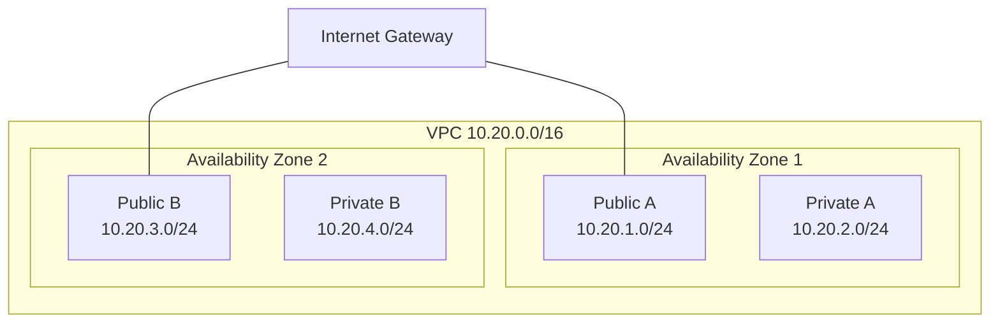
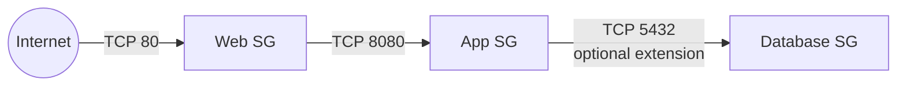
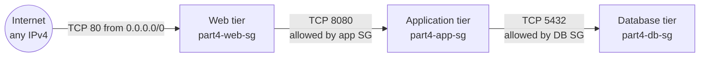
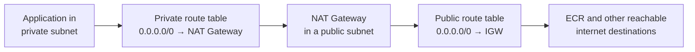

# AWS Lab: Build a VPC from Scratch (Console GUI and AWS CLI)

First build a VPC and security groups using the **AWS Management Console (GUI)**, then repeat the build from the command line using the **AWS CLI**. Along the way, verify every layer, create a chain of security groups, and reason through ECR and PrivateLink connectivity, **without provisioning a NAT Gateway**.

- **Region:** `us-east-1`
- **Tooling:** AWS Management Console (GUI steps) and AWS CLI on your Mac (CLI steps)
- **Safety:** your existing default VPC (`172.31.0.0/16`) is not modified

> **Cost note:** A VPC, subnets, route tables, Internet Gateway, and security groups generally have no direct hourly charge. This lab does **not** create EC2 instances, NAT Gateways, or other billable compute resources.

## Agenda

### Steps using GUI (AWS Management Console)

- [GUI Part A: Build a VPC from Scratch](#gui-part-a-build-a-vpc-from-scratch-console)
  - Step 1: Create a New VPC
  - Step 2: Add Four Subnets
  - Step 3: Create and Attach an Internet Gateway (IGW)
  - Step 4: Create a Route Table and Configure Public Subnets
  - Step 5: Verify Route Tables
- [GUI Part B: Security Groups](#gui-part-b-security-groups-console)
  - Step 1: Create Security Groups and Rules
  - Step 2: Verify SG2 Configuration

### Steps using CLI (AWS CLI)

1. [What we are going to build](#1-what-we-are-going-to-build)
2. [Part 1: Prepare your AWS CLI](#2-part-1-prepare-your-aws-cli)
3. [Part 2: Create the VPC](#3-part-2-create-the-vpc)
4. [Part 3: Create four subnets](#4-part-3-create-four-subnets)
5. [Part 4: Create and attach the Internet Gateway](#5-part-4-create-and-attach-the-internet-gateway)
6. [Part 5: Create the public route table](#6-part-5-create-the-public-route-table)
7. [Part 6: Verify two public and two private subnets](#7-part-6-verify-two-public-and-two-private-subnets)
8. [Part 7: Create the web and app security groups](#8-part-7-create-the-web-and-app-security-groups)
9. [Part 8: Database security group](#9-part-8-database-security-group)
10. [Part 9: Private subnet access to ECR](#10-part-9-private-subnet-access-to-ecr)
11. [Part 10: PrivateLink vs NAT Gateway](#11-part-10-privatelink-vs-nat-gateway)
12. [Cleanup (optional)](#12-cleanup-optional)
13. [Progress checklist](#13-progress-checklist)

### How the CLI parts map to the original lab steps

*(The GUI parts above are self-contained and are not part of this mapping.)*

| Part | Original lab step(s) | Topic |
|------|----------------------|-------|
| 1 | n/a | CLI preparation and conflict checks |
| 2 | 5 | Create the VPC |
| 3 | 6 | Create four subnets |
| 4 | 7 | Internet Gateway |
| 5 | 8 | Public route table |
| 6 | 9 | Verify public vs private |
| 7 | 10 to 11 | Web and app security groups |
| 8 | 12 | Database security group |
| 9 | 13 | ECR access from a private subnet |
| 10 | 14 | PrivateLink vs NAT Gateway |

---

## GUI Part A: Build a VPC from Scratch (Console)

> **Steps using GUI.** Everything in the two GUI parts is done in the AWS Management Console. The GUI exercise uses its own names and CIDR range (`my-custom-vpc`, `10.100.0.0/16`), separate from the CLI exercise later in this guide (`10.20.0.0/16`), so you can complete both without conflicts.

### Step 1: Create a New VPC

1. Open the Amazon VPC console at <https://console.aws.amazon.com/vpc/>.
2. In the top navigation bar, ensure you select your desired AWS Region (e.g., `us-east-1`).
3. In the left navigation pane, click **Your VPCs**, then click **Create VPC**.
4. Select **VPC only**.
5. Configure your settings:
   * **Name tag:** `my-custom-vpc`
   * **IPv4 CIDR block:** `10.100.0.0/16`
   * **Tenancy:** Default
6. Click **Create VPC**.
7. **Verify:** Once created, click on your VPC in the list and check its details to confirm the ID and CIDR block match.

### Step 2: Add Four Subnets

1. In the left navigation pane, click **Subnets**, then click **Create subnet**.
2. Select your `my-custom-vpc` from the **VPC ID** dropdown.
3. Create the subnets one by one using these configurations:
   * **Subnet 1 (Public, AZ 1):**
      * Name: `public-subnet-1`
      * Availability Zone: `us-east-1a` (or your region's first AZ)
      * IPv4 CIDR block: `10.100.1.0/24`
   * **Subnet 2 (Private, AZ 1):**
      * Name: `private-subnet-1`
      * Availability Zone: `us-east-1a`
      * IPv4 CIDR block: `10.100.2.0/24`
   * **Subnet 3 (Public, AZ 2):**
      * Name: `public-subnet-2`
      * Availability Zone: `us-east-1b` (or your region's second AZ)
      * IPv4 CIDR block: `10.100.3.0/24`
   * **Subnet 4 (Private, AZ 2):**
      * Name: `private-subnet-2`
      * Availability Zone: `us-east-1b`
      * IPv4 CIDR block: `10.100.4.0/24`
4. Click **Create subnet** after configuring each one.

### Step 3: Create and Attach an Internet Gateway (IGW)

1. In the left navigation pane, click **Internet gateways**, then click **Create internet gateway**.
2. **Name tag:** `my-igw`. Click **Create internet gateway**.
3. After creation, you will see a banner saying it's detached. Click **Actions → Attach to VPC**.
4. Select your `my-custom-vpc` and click **Attach internet gateway**.
5. **Verify:** Check the **Internet gateways** page. Ensure the state says `Attached` and maps to your VPC ID.

### Step 4: Create a Route Table and Configure Public Subnets

1. In the left navigation pane, click **Route tables**, then click **Create route table**.
2. **Name:** `public-route-table`, **VPC:** select `my-custom-vpc`. Click **Create route table**.
3. Select your new route table, look at the bottom tabs, and click **Routes → Edit routes**.
4. Click **Add route**:
   * **Destination:** `0.0.0.0/0`
   * **Target:** Select **Internet Gateway**, then choose your `my-igw` ID.
5. Click **Save changes**.
6. Now, link this route table to your two public subnets:
   * Go back to the **Route tables** list, select your `public-route-table`, click the **Subnet associations** tab, and click **Edit subnet associations**.
   * Check the boxes for `public-subnet-1` and `public-subnet-2`.
   * Click **Save associations**.

> Your private subnets will remain on the default **Main Route Table**, which only contains local routing.

### Step 5: Verify Route Tables

1. In **Route tables**, click on your custom `public-route-table`.
2. Verify under the **Subnet associations** tab that exactly two subnets are associated here.
3. Check the default route table of your VPC; verify that your two private subnets are associated there, and their only route is local (`10.100.0.0/16`).

---

## GUI Part B: Security Groups (Console)

> This is the "Part 4: Security Groups" section of the GUI exercise, renamed here to avoid confusion with CLI "Part 4" (Internet Gateway) later in this guide.

### Step 1: Create Security Groups and Rules

1. In the left navigation pane of the VPC console, click **Security groups**, then click **Create security group**.
2. **Create Web SG (`web-sg`):**
   * **Security group name:** `web-sg`
   * **Description:** `Web server security group`
   * **VPC:** select `my-custom-vpc`
   * Under **Inbound rules**, click **Add rule**:
      * **Type:** `HTTP`
      * **Source:** `Anywhere-IPv4` (`0.0.0.0/0`)
   * Click **Create security group**.
3. **Create App SG (`app-sg`):**
   * Click **Create security group** again.
   * **Security group name:** `app-sg`
   * **Description:** `App server security group`
   * **VPC:** select `my-custom-vpc`
   * Under **Inbound rules**, click **Add rule**:
      * **Type:** `HTTPS` (or custom port)
      * **Source:** Type **Custom**, and search/select your `web-sg` security group ID as the source.
   * Click **Create security group**.

### Step 2: Verify SG2 Configuration

1. Click on **Security groups** and select your newly created `app-sg`.
2. Look at the **Inbound rules** tab.
3. Confirm that the source is listed as a security group reference (showing the `web-sg` ID) rather than an IP CIDR block.

---

# Steps using CLI

The remaining sections of this guide build a similar VPC entirely from the AWS CLI.

## 1. What we are going to build

**New VPC:** `10.20.0.0/16` (we check for CIDR conflicts before creating it).

| Subnet | CIDR | Availability Zone | Routing | Type |
|--------|------|-------------------|---------|------|
| Public A  | `10.20.1.0/24` | AZ 1 | Route to IGW | Public |
| Private A | `10.20.2.0/24` | AZ 1 | Local route only | Private |
| Public B  | `10.20.3.0/24` | AZ 2 | Route to IGW | Public |
| Private B | `10.20.4.0/24` | AZ 2 | Local route only | Private |



### Security group chain



### Route table design

- The **public route table** is associated with only the two public subnets.
- The two **private subnets** stay on the new VPC's **main route table**, which should have only its local route.

---

## 2. Part 1: Prepare your AWS CLI

### Step 1. Check your account and region

```bash
aws sts get-caller-identity
```

```bash
aws configure get region
```

Your previous configuration used `us-east-1`. To avoid working in the wrong region by accident, every command below specifies `--region` explicitly.

> Check that the account ID matches the AWS training account you intend to use.

### Step 2. Check for CIDR conflicts

Before choosing `10.20.0.0/16`, list the VPCs in the region:

```bash
aws ec2 describe-vpcs \
  --region us-east-1 \
  --query 'Vpcs[*].{VpcId:VpcId,CIDR:CidrBlock,Default:IsDefault,State:State}' \
  --output table
```

Look for an existing VPC using `10.20.0.0/16` or an overlapping range.

If the range is already in use, choose another private IPv4 range such as `10.30.0.0/16` and adjust the four subnet ranges to match. Avoid overlaps with any networks that will need to communicate with this VPC.

### Step 3. Identify two available Availability Zones

```bash
aws ec2 describe-availability-zones \
  --region us-east-1 \
  --query 'AvailabilityZones[?State==`available`].ZoneName' \
  --output table
```

Choose two different available AZ names from your output, for example `us-east-1a` and `us-east-1b` if both appear.

> Availability Zone names can map to different physical zones across AWS accounts, so use the names available in **your** account.

---

## 3. Part 2: Create the VPC

*(Original lab step 5)*

### Step 4. Create the VPC

Once you have confirmed that the CIDR range is available:

```bash
export AWS_REGION=us-east-1

VPC_ID=$(aws ec2 create-vpc \
  --region "$AWS_REGION" \
  --cidr-block 10.20.0.0/16 \
  --tag-specifications \
  'ResourceType=vpc,Tags=[{Key=Name,Value=part3-lab-vpc}]' \
  --query 'Vpc.VpcId' \
  --output text)

echo "$VPC_ID"
```

What this does:

- Creates a new VPC with CIDR `10.20.0.0/16`.
- Adds a `Name` tag so you can identify it in the AWS Console.
- Stores the generated VPC ID in the shell variable `VPC_ID` (it will look like `vpc-...`; yours will differ).

Wait until the VPC is available:

```bash
aws ec2 wait vpc-available \
  --region "$AWS_REGION" \
  --vpc-ids "$VPC_ID"
```

Verify it:

```bash
aws ec2 describe-vpcs \
  --region "$AWS_REGION" \
  --vpc-ids "$VPC_ID" \
  --query 'Vpcs[*].{VpcId:VpcId,CIDR:CidrBlock,State:State,Default:IsDefault}' \
  --output table
```

**Expected result:** your new VPC appears with CIDR `10.20.0.0/16`, state `available`, and `Default` set to `False`.

> **Do not proceed** if the creation command fails or the VPC is not available.

---

## 4. Part 3: Create four subnets

*(Original lab step 6)*

| Subnet | CIDR | Availability Zone | Purpose |
|--------|------|-------------------|---------|
| Public A  | `10.20.1.0/24` | AZ 1 | Public |
| Private A | `10.20.2.0/24` | AZ 1 | Private |
| Public B  | `10.20.3.0/24` | AZ 2 | Public |
| Private B | `10.20.4.0/24` | AZ 2 | Private |

Each `/24` contains 256 IPv4 addresses. AWS reserves **five** addresses per subnet, leaving **251** usable for typical AWS resources.

### Step 5. Set your AZ variables

Replace these example values with the two AZs you verified earlier, if necessary.

```bash
export AZ1=us-east-1a
export AZ2=us-east-1b
```

Verify:

```bash
echo "$AZ1"
echo "$AZ2"
```

### Step 6. Create the four subnets

Run these in the **same terminal** where `VPC_ID` is set.

**Public subnet A**

```bash
PUBLIC_A=$(aws ec2 create-subnet \
  --region "$AWS_REGION" \
  --vpc-id "$VPC_ID" \
  --cidr-block 10.20.1.0/24 \
  --availability-zone "$AZ1" \
  --tag-specifications \
  'ResourceType=subnet,Tags=[{Key=Name,Value=part3-public-a}]' \
  --query 'Subnet.SubnetId' \
  --output text)
```

**Private subnet A**

```bash
PRIVATE_A=$(aws ec2 create-subnet \
  --region "$AWS_REGION" \
  --vpc-id "$VPC_ID" \
  --cidr-block 10.20.2.0/24 \
  --availability-zone "$AZ1" \
  --tag-specifications \
  'ResourceType=subnet,Tags=[{Key=Name,Value=part3-private-a}]' \
  --query 'Subnet.SubnetId' \
  --output text)
```

**Public subnet B**

```bash
PUBLIC_B=$(aws ec2 create-subnet \
  --region "$AWS_REGION" \
  --vpc-id "$VPC_ID" \
  --cidr-block 10.20.3.0/24 \
  --availability-zone "$AZ2" \
  --tag-specifications \
  'ResourceType=subnet,Tags=[{Key=Name,Value=part3-public-b}]' \
  --query 'Subnet.SubnetId' \
  --output text)
```

**Private subnet B**

```bash
PRIVATE_B=$(aws ec2 create-subnet \
  --region "$AWS_REGION" \
  --vpc-id "$VPC_ID" \
  --cidr-block 10.20.4.0/24 \
  --availability-zone "$AZ2" \
  --tag-specifications \
  'ResourceType=subnet,Tags=[{Key=Name,Value=part3-private-b}]' \
  --query 'Subnet.SubnetId' \
  --output text)
```

Display the subnet IDs:

```bash
echo "Public A:  $PUBLIC_A"
echo "Private A: $PRIVATE_A"
echo "Public B:  $PUBLIC_B"
echo "Private B: $PRIVATE_B"
```

### Step 7. Verify all four subnets

```bash
aws ec2 describe-subnets \
  --region "$AWS_REGION" \
  --filters "Name=vpc-id,Values=$VPC_ID" \
  --query 'Subnets[*].{Name:Tags[?Key==`Name`]|[0].Value,SubnetId:SubnetId,CIDR:CidrBlock,AZ:AvailabilityZone,State:State}' \
  --output table
```

You should see four subnets, each with the expected CIDR and Availability Zone.

> At this stage the subnets exist, but you have **not yet** established which ones are public. That is determined by their **route tables**.

---

## 5. Part 4: Create and attach the Internet Gateway

*(Original lab step 7)*

### Step 8. Create the gateway

```bash
IGW_ID=$(aws ec2 create-internet-gateway \
  --region "$AWS_REGION" \
  --tag-specifications \
  'ResourceType=internet-gateway,Tags=[{Key=Name,Value=part3-lab-igw}]' \
  --query 'InternetGateway.InternetGatewayId' \
  --output text)

echo "$IGW_ID"
```

This creates the Internet Gateway, but it is **not yet attached** to your new VPC.

### Step 9. Attach it to your VPC

```bash
aws ec2 attach-internet-gateway \
  --region "$AWS_REGION" \
  --internet-gateway-id "$IGW_ID" \
  --vpc-id "$VPC_ID"
```

### Step 10. Verify the attachment

> Do not skip this verification.

```bash
aws ec2 describe-internet-gateways \
  --region "$AWS_REGION" \
  --internet-gateway-ids "$IGW_ID" \
  --query 'InternetGateways[*].{IGW:InternetGatewayId,Attachments:Attachments[*].{VpcId:VpcId,State:State}}' \
  --output json
```

**Expected result:** the attachment shows your new VPC ID and state `available`.

If the gateway is not attached successfully, resolve that before continuing.

---

## 6. Part 5: Create the public route table

*(Original lab step 8)*

A new VPC normally has a **main route table** containing a local route. We leave that table alone and create a **separate** route table for the two public subnets.

### Step 11. Create a new route table

```bash
PUBLIC_RT=$(aws ec2 create-route-table \
  --region "$AWS_REGION" \
  --vpc-id "$VPC_ID" \
  --tag-specifications \
  'ResourceType=route-table,Tags=[{Key=Name,Value=part3-public-rt}]' \
  --query 'RouteTable.RouteTableId' \
  --output text)

echo "$PUBLIC_RT"
```

### Step 12. Add the default route to the IGW

```bash
aws ec2 create-route \
  --region "$AWS_REGION" \
  --route-table-id "$PUBLIC_RT" \
  --destination-cidr-block 0.0.0.0/0 \
  --gateway-id "$IGW_ID"
```

This creates the route:

```
0.0.0.0/0  →  Internet Gateway
```

Verify it:

```bash
aws ec2 describe-route-tables \
  --region "$AWS_REGION" \
  --route-table-ids "$PUBLIC_RT" \
  --query 'RouteTables[*].Routes[*].{Destination:DestinationCidrBlock,Target:GatewayId,State:State}' \
  --output table
```

You should see **two** routes, both `active`:

| Destination | Target |
|-------------|--------|
| `10.20.0.0/16` | `local` |
| `0.0.0.0/0` | your `igw-...` ID |

### Step 13. Associate the public route table with only the two public subnets

```bash
aws ec2 associate-route-table \
  --region "$AWS_REGION" \
  --route-table-id "$PUBLIC_RT" \
  --subnet-id "$PUBLIC_A"
```

```bash
aws ec2 associate-route-table \
  --region "$AWS_REGION" \
  --route-table-id "$PUBLIC_RT" \
  --subnet-id "$PUBLIC_B"
```

We deliberately do **not** associate `PRIVATE_A` or `PRIVATE_B` with this route table. They remain on the VPC's main route table, which has only the local route by default.

### Optional: auto-assign public IPv4 on the public subnets

For a future EC2 demonstration, you can enable automatic public IPv4 assignment:

```bash
aws ec2 modify-subnet-attribute \
  --region "$AWS_REGION" \
  --subnet-id "$PUBLIC_A" \
  --map-public-ip-on-launch
```

```bash
aws ec2 modify-subnet-attribute \
  --region "$AWS_REGION" \
  --subnet-id "$PUBLIC_B" \
  --map-public-ip-on-launch
```

> This setting is optional for this routing lab. It does **not** make a subnet public; the **route table** does that.

---

## 7. Part 6: Verify two public and two private subnets

*(Original lab step 9)*

This is the most important verification of the VPC exercise.

### Step 14. Find the main route table

```bash
MAIN_RT=$(aws ec2 describe-route-tables \
  --region "$AWS_REGION" \
  --filters "Name=vpc-id,Values=$VPC_ID" \
            "Name=association.main,Values=true" \
  --query 'RouteTables[0].RouteTableId' \
  --output text)

echo "$MAIN_RT"
```

Inspect it:

```bash
aws ec2 describe-route-tables \
  --region "$AWS_REGION" \
  --route-table-ids "$MAIN_RT" \
  --query 'RouteTables[*].Routes[*].{Destination:DestinationCidrBlock,Target:GatewayId,State:State}' \
  --output table
```

**Expected result:** a single local route.

```
10.20.0.0/16  →  local
```

> If there is a default route to an IGW, **stop and investigate** before claiming the private subnets are private.

### Step 15. Verify the public route table's subnet associations

```bash
aws ec2 describe-route-tables \
  --region "$AWS_REGION" \
  --route-table-ids "$PUBLIC_RT" \
  --query 'RouteTables[*].{RouteTableId:RouteTableId,Main:Associations[?Main==`true`].Main,Subnets:Associations[*].SubnetId,Routes:Routes[*].[DestinationCidrBlock,GatewayId,State]}' \
  --output json
```

Confirm that:

- `Subnets` lists exactly the IDs in `$PUBLIC_A` and `$PUBLIC_B`.
- The table has an **active** default route to your IGW.

### Step 16. Verify all route tables in the VPC

```bash
aws ec2 describe-route-tables \
  --region "$AWS_REGION" \
  --filters "Name=vpc-id,Values=$VPC_ID" \
  --query 'RouteTables[*].{RouteTableId:RouteTableId,Associations:Associations[*].{Main:Main,SubnetId:SubnetId},Routes:Routes[*].[DestinationCidrBlock,GatewayId,State]}' \
  --output json
```

Use this output to establish the result:

| Subnet | Associated route table | Expected routing | Classification |
|--------|------------------------|------------------|----------------|
| Public A  | Public route table | Local + IGW default route | **Public** |
| Public B  | Public route table | Local + IGW default route | **Public** |
| Private A | Main route table   | Local only | **Private** |
| Private B | Main route table   | Local only | **Private** |

> **Reading the main route table:** if it shows no individual subnet IDs under `Associations`, that does not necessarily mean it has no associated subnets. The main route table's association is represented by `Main: true`. Subnets using it by default may not have individual subnet IDs listed.

**Success criterion:** exactly **two** subnets use the route table with `0.0.0.0/0 → IGW`, while the other **two** use the local-only main route table.

---

## 8. Part 7: Create the web and app security groups

*(Original lab steps 10 to 11)*

We create two security groups:

| Security group | Inbound rule |
|----------------|--------------|
| `part4-web-sg` | HTTP, TCP 80, from anywhere |
| `part4-app-sg` | TCP 8080, **only from** `part4-web-sg` |

Security groups belong to a VPC, so we use the **new VPC's ID**.

### Step 17. Create the web security group

```bash
WEB_SG=$(aws ec2 create-security-group \
  --region "$AWS_REGION" \
  --group-name part4-web-sg \
  --description "Public HTTP entry point for the lab" \
  --vpc-id "$VPC_ID" \
  --query 'GroupId' \
  --output text)

echo "$WEB_SG"
```

Allow HTTP from anywhere:

```bash
aws ec2 authorize-security-group-ingress \
  --region "$AWS_REGION" \
  --group-id "$WEB_SG" \
  --protocol tcp \
  --port 80 \
  --cidr 0.0.0.0/0
```

This opens inbound HTTP to resources associated with this security group, subject to the other network conditions.

> For this exercise, don't attach it to a production server. Port 80 open to the world is a broad rule, and it does not encrypt HTTP traffic.

### Step 18. Create the application security group

```bash
APP_SG=$(aws ec2 create-security-group \
  --region "$AWS_REGION" \
  --group-name part4-app-sg \
  --description "Application tier accepts traffic from web tier only" \
  --vpc-id "$VPC_ID" \
  --query 'GroupId' \
  --output text)

echo "$APP_SG"
```

Allow TCP port 8080 **only from the web security group**:

```bash
aws ec2 authorize-security-group-ingress \
  --region "$AWS_REGION" \
  --group-id "$APP_SG" \
  --protocol tcp \
  --port 8080 \
  --source-group "$WEB_SG"
```

The critical part is `--source-group "$WEB_SG"`.

We are **not** specifying a CIDR range. Instead, we are saying traffic is permitted from network interfaces associated with the referenced security group. The application tier's inbound rule therefore does not allow every IP address on the internet to connect to port 8080.

### Step 19. Verify the app security group's ingress rule

```bash
aws ec2 describe-security-groups \
  --region "$AWS_REGION" \
  --group-ids "$APP_SG" \
  --query 'SecurityGroups[*].{GroupId:GroupId,GroupName:GroupName,Ingress:IpPermissions[*].{Protocol:IpProtocol,FromPort:FromPort,ToPort:ToPort,IpRanges:IpRanges,UserIdGroupPairs:UserIdGroupPairs}}' \
  --output json
```

Look for a permission containing:

| Field | Expected value |
|-------|----------------|
| `FromPort` | `8080` |
| `ToPort` | `8080` |
| `IpRanges` | an **empty list** |
| `UserIdGroupPairs` | a list containing your `$WEB_SG` ID |

This is the exact proof the lab asks for in step 11.

> AWS security groups also have default **outbound** rules when created. We have not modified them; this exercise focuses on inbound traffic.

---

## 9. Part 8: Database security group

*(Original lab step 12)*

Imagine adding a third security group for a PostgreSQL database.

**Question:** which existing group should be allowed to reach the database?

**Answer:** `part4-app-sg`, **not** `part4-web-sg`.

### Intended architecture

| Tier | Security group | Inbound rule |
|------|----------------|--------------|
| Internet | n/a | Any IPv4 address |
| Web | `part4-web-sg` | TCP 80 from `0.0.0.0/0` |
| Application | `part4-app-sg` | TCP 8080 from the web SG |
| Database | `part4-db-sg` | TCP 5432 from the app SG only |



### Why not allow the web SG to reach the database directly?

The web SG accepts inbound HTTP from the entire internet. If the database SG references the web SG, every network interface associated with that SG could be an authorized source for the database rule.

The safer principle is **least privilege**: the database should accept connections only from the application tier that actually needs database access.

### Practice commands (no database instance required)

```bash
DB_SG=$(aws ec2 create-security-group \
  --region "$AWS_REGION" \
  --group-name part4-db-sg \
  --description "Database accepts PostgreSQL from application tier only" \
  --vpc-id "$VPC_ID" \
  --query 'GroupId' \
  --output text)
```

```bash
aws ec2 authorize-security-group-ingress \
  --region "$AWS_REGION" \
  --group-id "$DB_SG" \
  --protocol tcp \
  --port 5432 \
  --source-group "$APP_SG"
```

Verify the database SG with `describe-security-groups` in the same way as the application SG (Step 19).

---

## 10. Part 9: Private subnet access to ECR

*(Original lab step 13, conceptual, nothing is provisioned)*

**Scenario:** an application in a private subnet needs to pull a container image from Amazon Elastic Container Registry (ECR). There are two common approaches.

### Option A: Use a NAT Gateway

A NAT Gateway lets resources in private subnets **initiate outbound IPv4 connections** to destinations such as public AWS service endpoints.



You would need to:

1. Create a NAT Gateway in a **public** subnet and allocate an Elastic IP address.
2. Ensure the public subnet's route table has a route to the Internet Gateway.
3. Add `0.0.0.0/0 → NAT Gateway` to the **private** route table.

> **Answer to the route-table question:** add the NAT route to the **private** route table, not the public route table.

We do not execute these steps because the lab says not to provision a NAT Gateway, and NAT Gateways incur charges.

### Option B: Use AWS PrivateLink and VPC endpoints

For ECR image pulls, you can use private connectivity to the relevant AWS services instead of sending traffic through a NAT Gateway.

Typically you need:

| Endpoint | Type | Why |
|----------|------|-----|
| `com.amazonaws.us-east-1.ecr.api` | Interface endpoint | ECR API calls |
| `com.amazonaws.us-east-1.ecr.dkr` | Interface endpoint | Docker registry (image pulls) |
| S3 | **Gateway** endpoint | ECR image layers are stored in Amazon S3 |

How they work:

- **Interface endpoints** use private network interfaces (ENIs) in your VPC.
- The **S3 gateway endpoint** adds routes to the route tables you select, such as the private route table.
- Endpoint **security groups and policies** must also permit the required traffic.

For a real deployment you may need connectivity to other services too, depending on how the application obtains credentials, logs output, and operates.

No NAT Gateway or endpoint needs to be created for this conceptual exercise.

---

## 11. Part 10: PrivateLink vs NAT Gateway

*(Original lab step 14)*

| Feature | NAT Gateway | PrivateLink / VPC endpoints |
|---------|-------------|-----------------------------|
| Main purpose | General outbound IPv4 connectivity | Private connectivity to specific supported services |
| Public internet access | Can provide outbound access through an IGW | Not general-purpose internet access |
| Traffic destination | Many reachable external destinations | Selected AWS or supported endpoint services |
| Public IP needed on private instance | No | No |
| Route configuration | Private route table can send `0.0.0.0/0` to NAT | Interface endpoints use private DNS and network interfaces; gateway endpoints update selected route tables |
| ECR image pulls | Can work through public ECR endpoints | Can access ECR and S3 through the relevant endpoints |
| Main trade-off | Broader connectivity, with ongoing costs | More targeted connectivity, but requires the right endpoints and configuration |

### In your own words

- A **NAT Gateway** gives private instances a way to initiate outbound connections to many destinations, including the public internet, without assigning them public IP addresses.
- **PrivateLink** gives resources private connectivity to specific supported services without requiring their traffic to traverse the public internet.

PrivateLink is **not** a replacement for every use of NAT. If an application needs to reach arbitrary public websites, a NAT Gateway may be appropriate. If it only needs selected AWS services, VPC endpoints may provide a more restricted architecture.

---

## 12. Cleanup (optional)

> **Added section:** the original lab does not include cleanup. These resources have no hourly charge, but removing them keeps your account tidy. Run in the same terminal so the variables are still set.

Order matters: remove things that depend on other things first.

```bash
# 1. Security groups (db references app, app references web, so delete in this order)
aws ec2 delete-security-group --region "$AWS_REGION" --group-id "$DB_SG"
aws ec2 delete-security-group --region "$AWS_REGION" --group-id "$APP_SG"
aws ec2 delete-security-group --region "$AWS_REGION" --group-id "$WEB_SG"

# 2. Disassociate the public route table from its subnets, then delete it
for ASSOC in $(aws ec2 describe-route-tables \
    --region "$AWS_REGION" \
    --route-table-ids "$PUBLIC_RT" \
    --query 'RouteTables[0].Associations[?Main==`false`].RouteTableAssociationId' \
    --output text); do
  aws ec2 disassociate-route-table --region "$AWS_REGION" --association-id "$ASSOC"
done
aws ec2 delete-route-table --region "$AWS_REGION" --route-table-id "$PUBLIC_RT"

# 3. Detach and delete the Internet Gateway
aws ec2 detach-internet-gateway --region "$AWS_REGION" \
  --internet-gateway-id "$IGW_ID" --vpc-id "$VPC_ID"
aws ec2 delete-internet-gateway --region "$AWS_REGION" --internet-gateway-id "$IGW_ID"

# 4. Subnets
for S in "$PUBLIC_A" "$PRIVATE_A" "$PUBLIC_B" "$PRIVATE_B"; do
  aws ec2 delete-subnet --region "$AWS_REGION" --subnet-id "$S"
done

# 5. The VPC itself (its main route table is removed automatically)
aws ec2 delete-vpc --region "$AWS_REGION" --vpc-id "$VPC_ID"
```

---

## 13. Progress checklist

- [ ] Confirmed the AWS account ID and region
- [ ] Checked for CIDR conflicts (no overlap with `10.20.0.0/16`)
- [ ] Picked two available Availability Zones
- [ ] Created the VPC `10.20.0.0/16` and confirmed `available` and `Default: False`
- [ ] Created four subnets and verified CIDRs and AZs
- [ ] Created the Internet Gateway, attached it, and verified `available`
- [ ] Created the public route table with `0.0.0.0/0 → IGW`
- [ ] Associated the public route table with only Public A and Public B
- [ ] Confirmed the main route table has only the local route
- [ ] Classified subnets: 2 public, 2 private
- [ ] Created `part4-web-sg` (TCP 80 from anywhere)
- [ ] Created `part4-app-sg` (TCP 8080 from the web SG, empty `IpRanges`)
- [ ] Created `part4-db-sg` (TCP 5432 from the app SG)
- [ ] Can explain NAT Gateway vs PrivateLink for ECR access

### Variables used in this lab

| Variable | Holds |
|----------|-------|
| `AWS_REGION` | `us-east-1` |
| `VPC_ID` | The new VPC ID |
| `AZ1`, `AZ2` | The two Availability Zone names |
| `PUBLIC_A`, `PRIVATE_A`, `PUBLIC_B`, `PRIVATE_B` | The four subnet IDs |
| `IGW_ID` | The Internet Gateway ID |
| `PUBLIC_RT` | The public route table ID |
| `MAIN_RT` | The VPC's main route table ID |
| `WEB_SG`, `APP_SG`, `DB_SG` | The three security group IDs |
